<p align="center">
  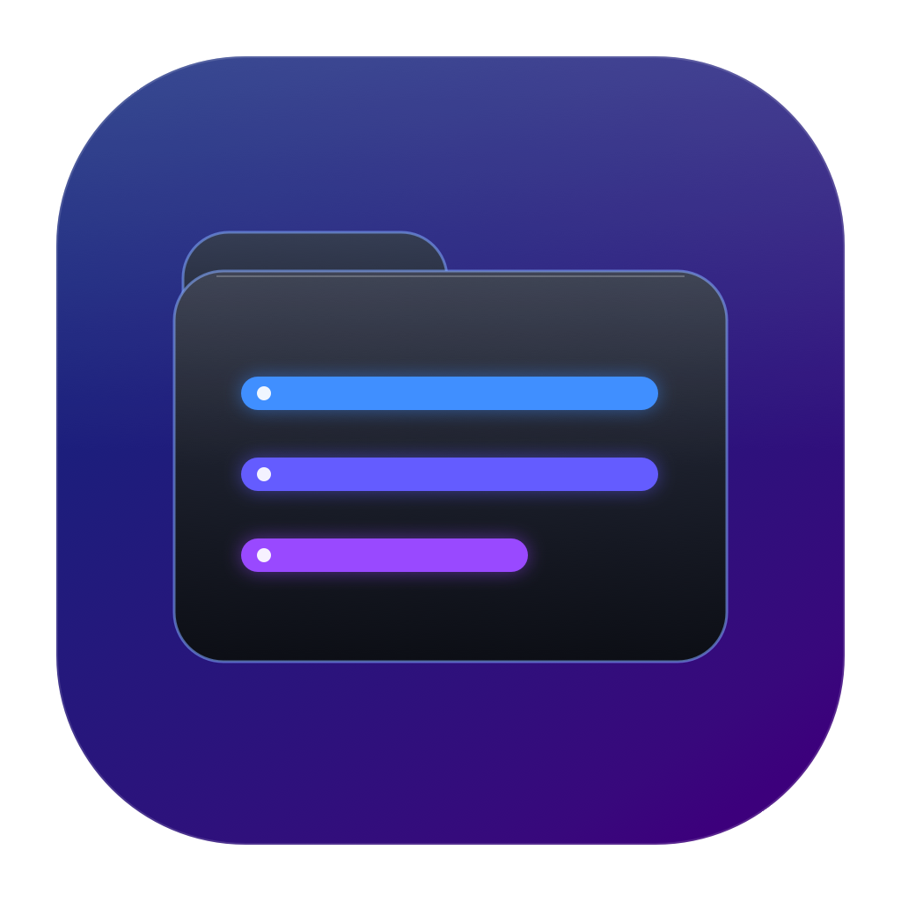
</p>

<h1 align="center">UU Explorer</h1>

<p align="center">
  A native, Windows Explorer-style file browser for macOS.<br>
  Fast keyboard navigation, tabs and split panes, Spotlight search, custom columns, batch rename, folder sizes, archive browsing, user-defined actions, and a real command palette.
</p>

<p align="center">
  <a href="https://github.com/uulabs/UU-Explorer-MacOS/releases/latest"></a>
  
  
  <a href="https://github.com/uulabs/UU-Explorer-MacOS/actions/workflows/ci.yml"></a>
</p>

<p align="center">
  <a href="https://github.com/uulabs/UU-Explorer-MacOS/releases/latest"><b>Download the latest release →</b></a>
</p>

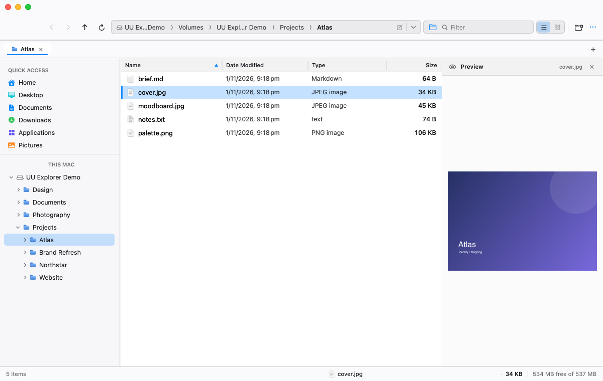

## Why UU Explorer

UU Explorer is a real AppKit/SwiftUI application, not a Finder skin. It brings the density and speed of a classic two-pane file manager to macOS without giving up native Quick Look, TCC-aware volume access, or macOS sharing and Open With integrations.

- **Keyboard-first**: menu shortcuts, Space Quick Look, ⌘K command palette, and arrow-key gallery navigation.
- **Built for large folders**: sortable details view, live filtering, recursive search, and on-demand folder sizing.
- **Real file operations**: a cancellable byte-aware transfer queue with pause/resume, speed, ETA, optional SHA-256 verification, conflict choices, and undo/redo.
- **Automation without a plugin runtime**: browse archives, define shell actions, copy paths in four formats, and open locations from the `uu` CLI or a URL scheme.
- **Native integrations**: Quick Look, Open With, Share, Terminal, Trash, Finder reveal, and mounted volumes.
- **No account, telemetry, or bundled network service**: file browsing stays on the Mac.

## Features

### Browse

- **Details and Gallery views** with remembered per-tab sort, filter, view mode, and selection.
- **Tabs** with session restore, reopen-closed-tab, drag reordering, and per-tab history.
- **Split view** with two independent browser panes and active-pane menu routing.
- **Path bar** with parent folders, breadcrumbs, autocomplete, and a folder browser.
- **Sidebar tree** for mounted volumes and lazy folder expansion, plus pinned Favourites.
- **Quick Look** and an optional preview pane for images, folders, and supported documents.
- **Drag and drop** into folder rows, sidebar destinations, gallery cards, and tabs.

### Find and organize

- **Filename and content search** with a filter builder for size, kind, modified date, and scope.
- **Large-file search** that walks the folder tree directly and works on unindexed volumes.
- **Saved searches** in the sidebar, with one-click reruns.
- **Archive browser** for ZIP, TAR, RAR, and 7-Zip contents without extracting the whole archive.
- **Batch rename** with live preview for find/replace, prefix/suffix, or numbering.
- **Undo/redo** for copy, move, rename, create, Trash, and supported archive operations.
- **Folder sizes** in the Size column and selection status, plus a Storage Usage panel.
- **Volume Properties** with capacity, format, mount point, UUID, media type, and access details.

### Take action

- **Byte-level operation queue** with speed, ETA, pause/resume, cancel, and Replace / Keep Both / Skip / Apply to All conflict handling.
- **Transfer verification** via SHA-256 tree comparison, enabled from the More menu or command palette.
- **Android devices over ADB**: browse `/sdcard`, open files, pull, and push.
- **Install APK on connected device** from the file context menu, with a device submenu.
- **Eject** external volumes and mounted disk images from the sidebar.
- **Dual-pane F5/F6** copy and move between panes.
- **Folder comparison sheet** for left-only, right-only, changed, and identical entries, with copy-left/right actions.
- **Metadata inspector** for POSIX permissions, owner/group, hard links, xattrs, ACLs, symlinks, quarantine, image metadata, and streamed SHA-256.
- **Custom details columns** for date created, size on disk, permissions, and owner, plus per-folder view/sort memory.
- **Archive browser** with selective Open and Extract Selected, without unpacking unrelated files.
- **Custom shell actions** with Selected Items or Current Folder scope, optional Terminal execution, and a persistent manager.
- **Copy Path As** POSIX, File URL, shell-quoted, or JSON.
- **`uu` CLI and `uu-explorer://` URL scheme** for opening folders and files from scripts, Shortcuts, or another app.
- **Open With**, **Quick Actions**, and the system **Share** picker.
- **Compress**, **Extract Here/To…**, **RAR/7-Zip extraction**, and password-protected ZIP creation.
- **Saved SMB/AFP/NFS shares** with a three-step setup wizard, optional reconnect at launch, and optional Launch at Login for persistence across restarts. Credentials stay in the macOS keychain.
- **Command palette** for file, view, search, sizing, and settings actions.
- **Ten theme presets**, independent light/dark palettes, and eight folder icon styles.

## Screenshots

### Gallery

<a href="Screenshots/gallery.png">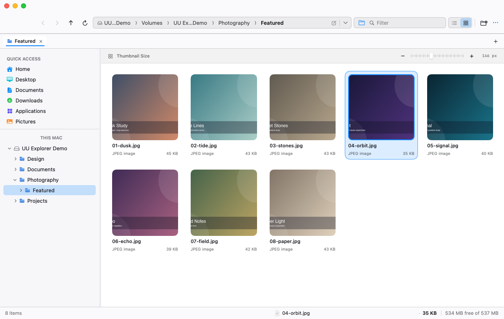</a>

### Split view

<a href="Screenshots/split-view.png">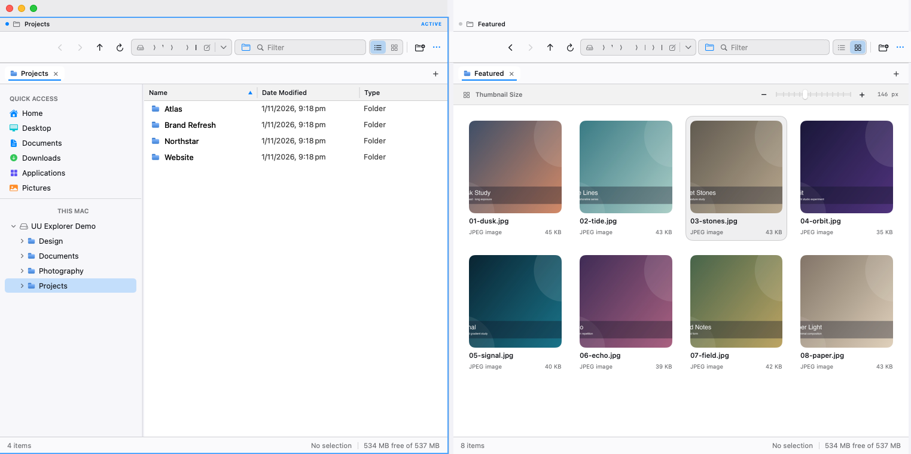</a>

### Command palette

<a href="Screenshots/command-palette.png">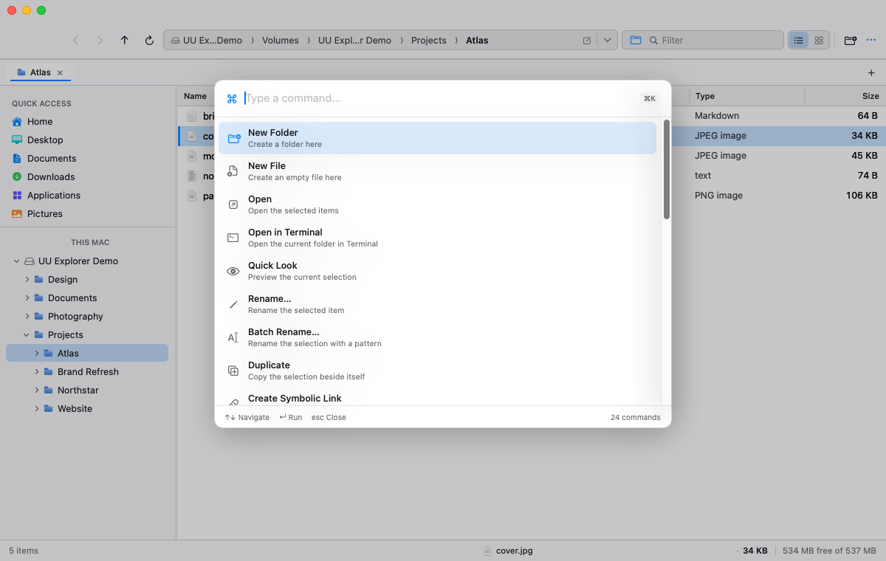</a>

### Recursive search

<a href="Screenshots/search.png">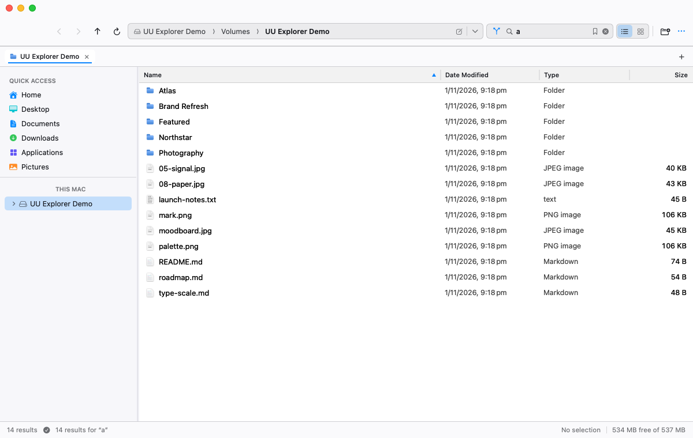</a>

### Archive browser

<a href="Screenshots/archive-browser.png">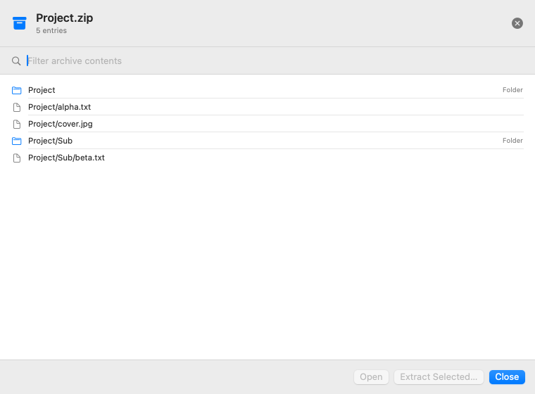</a>

### Custom actions

<a href="Screenshots/custom-actions.png">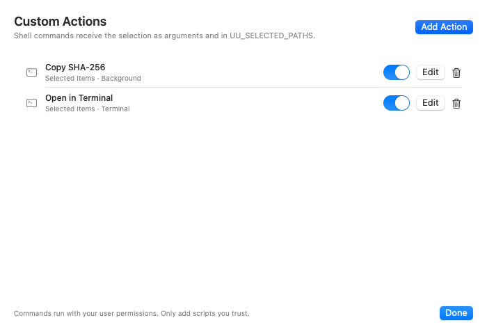</a>

### Custom columns

<a href="Screenshots/columns.png">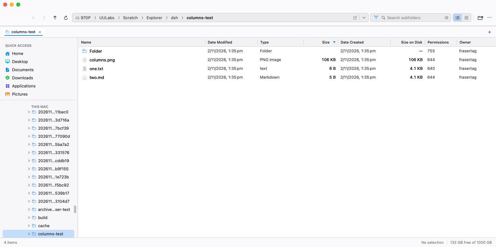</a>

### Folder compare

<a href="Screenshots/folder-compare.png">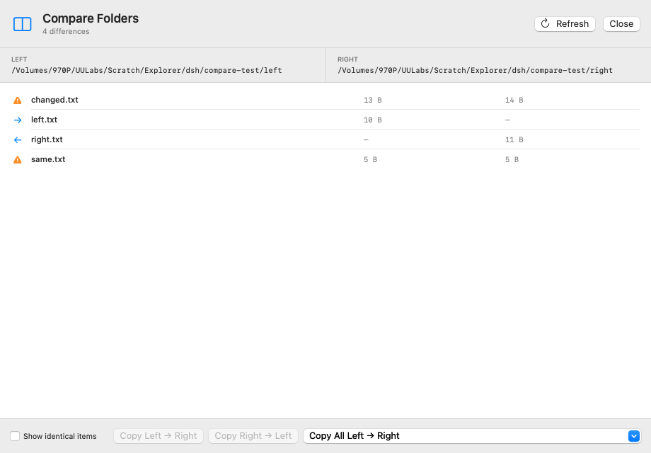</a>

### Network share wizard

<a href="Screenshots/network-wizard.png">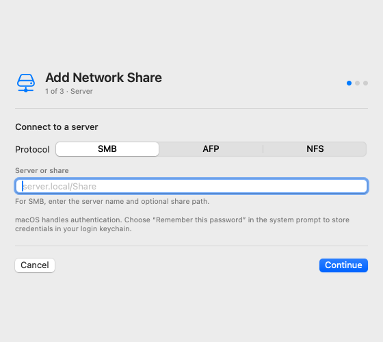</a>

### Android devices

<a href="Screenshots/android-browser.png">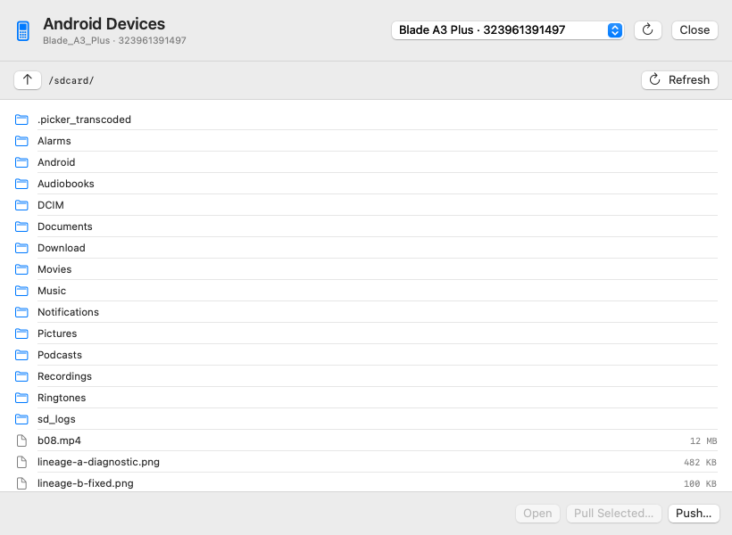</a>

## Install

Requires **macOS 14 or later** on Apple Silicon.

1. Download the latest **`.dmg`** from [Releases](https://github.com/uulabs/UU-Explorer-MacOS/releases/latest).
2. Open the disk image and drag **UU Explorer** into **Applications**.
3. Launch it from Applications.

The app is developer-signed, not notarized. If macOS blocks the first launch, Control-click the app, choose **Open**, then confirm. You can also allow it from **System Settings → Privacy & Security**.

### First run and permissions

UU Explorer is non-sandboxed so it can browse the folders you open, including external volumes. macOS may ask for access to Desktop, Documents, Downloads, removable volumes, or protected locations. Full Disk Access is optional and only needed for protected system locations.

## Automatic updates

UU Explorer checks the latest **stable GitHub release** after launch and every six hours. When a newer release exists, it presents **Install Update / Later / Skip This Version**. **Later** pauses automatic prompts for 24 hours; **Skip This Version** suppresses that version until something newer is released. You can also choose **UU Explorer → Check for Updates…** at any time.

An update is offered only after the app verifies:

- the release is stable and the version is newer;
- the downloaded archive matches the published **SHA-256** sidecar;
- the extracted app has bundle ID `com.uulabs.uuexplorer`;
- the app is signed with UULabs’ Team ID `V726L7NR7H`;
- the bundle version matches the GitHub release tag.

The app asks before installing. On approval, a small relaunch helper atomically replaces the app and reopens it. Updates are not installed silently. The updater uses the public GitHub API and does not contain or require a GitHub token.

You can disable automatic checks from **UU Explorer → Automatically Check for Updates**.

## Keyboard shortcuts

| Shortcut | Action |
|---|---|
| ⌘K | Command palette |
| ⌘T / ⌘W | New tab / close tab |
| ⇧⌘T | Reopen closed tab |
| ⌃Tab / ⌃⇧Tab | Next / previous tab |
| ⌘N / ⌃⌘N | New window / move tab to new window |
| ⌘\\ | Toggle split view |
| ⌘1 / ⌘2 | Details / Gallery |
| Space | Quick Look |
| Return | Open selection |
| F2 | Rename |
| ⌥⌘R | Batch rename |
| ⌘⌫ | Move to Trash |
| ⌘Z / ⇧⌘Z | Undo / redo file operation |
| ⌘L | Edit path |
| ⇧⌘. | Show hidden files |
| ⌘, | Settings |

## Shell and URL integration

Install the `uu` helper on your `PATH`:

```bash
./scripts/install-cli.sh
export PATH="$HOME/.local/bin:$PATH"
```

Then `uu .`, `uu ~/Downloads`, or `uu path/to/file` opens the location in UU Explorer. The helper uses the registered `uu-explorer://open?path=…` URL scheme, so it also works from Shortcuts, Alfred, Raycast, or any script:

```bash
open -b com.uulabs.uuexplorer "uu-explorer://open?path=$HOME/Downloads"
```

Custom actions receive the current folder and selection through:

- `$@` — selected paths (or the current folder)
- `$UU_SELECTED_PATHS` — newline-separated paths
- `$UU_FIRST_PATH`, `$UU_CURRENT_DIR`, `$UU_SELECTED_COUNT`, `$UU_APP`

Commands run with your user permissions. Only add scripts you trust.

## Build from source

Requirements: macOS 14+, Xcode command-line tools, and Swift 6.

```bash
git clone git@github.com:uulabs/UU-Explorer-MacOS.git
cd UU-Explorer-MacOS
swift test
./scripts/build-app.sh
open "dist/UU Explorer.app"
```

Create a drag-to-Applications disk image:

```bash
./scripts/build-dmg.sh
```

Create the updater assets (ZIP + SHA-256 + DMG checksum):

```bash
./scripts/build-release.sh
```

See [RELEASING.md](RELEASING.md) for the release checklist and the permissions required by `gh release create`.

`build-app.sh` uses `.build` by default. Set `UU_BUILD_DIR` to use another build directory, and set `CODESIGN_IDENTITY` to choose a signing identity; without one, the script falls back to an available Developer ID/Apple Development identity or ad-hoc signing.

## Architecture

```
Sources/ExplorerCore/        Testable filesystem, archive, search, sizing, and update primitives
Sources/Explorer/Model/      ExplorerModel, tabs, panes, undo, operation queue
Sources/Explorer/Views/      AppKit table + SwiftUI shell, settings, palette, sheets
Sources/Explorer/Support/    Window integration, Quick Look, updater, transfer session, sharing
Tests/                       ExplorerCore unit tests
scripts/                     Portable app, DMG, release, test, and icon scripts
```

- Swift 6 toolchain using Swift 5 language mode for AppKit/SwiftUI compatibility.
- AppKit `NSTableView` for the details grid; SwiftUI for the shell, palettes, sheets, and settings.
- One `ExplorerModel` per browser pane; tabs restore folder, history, selection, sort, filter, and view mode.
- Theme settings persist to `~/Library/Application Support/UU Explorer/theme.json` and UserDefaults.
- Custom actions persist to `~/Library/Application Support/UU Explorer/custom-actions.json`; `UU_EXPLORER_ACTIONS_FILE` can isolate them for tests.
- Archive extraction uses `/usr/bin/bsdtar` for entry-level listing and selective extraction; encrypted RAR/7-Zip still requires a compatible external tool.
- No third-party runtime dependencies.

## Testing

```bash
swift test
```

The repository includes 67 `ExplorerCore` tests covering path handling, sorting, archive round-trips, archive entry selection, search filters, folder comparison, batch rename planning, folder sizes, volume metadata, network address parsing, transfer byte accounting and verification, file hashing, and update release/checksum selection.

## Security and privacy

- No analytics, telemetry, accounts, or background uploads.
- Update archives are pinned to the UULabs Team ID and verified against a published SHA-256 before installation.
- Network-location credentials are handled by macOS; UU Explorer stores only the display name and URL.
- Encrypted ZIP creation uses the system `zip` tool’s classic ZipCrypto format, not modern AES. Use a strong passphrase and treat it as compatibility encryption.
- RAR/7-Zip extraction uses installed 7-Zip, unar, or unrar where available, with the system `bsdtar` libarchive fallback. Encrypted RAR/7-Zip archives require a compatible external tool.

## Contributing

Issues and focused pull requests are welcome. For larger changes, please open an issue first so the approach and compatibility impact can be discussed.

## License

Copyright © 2026 UULabs. All rights reserved.

The source is published for transparency and evaluation. No license is granted for redistribution or derivative works.
